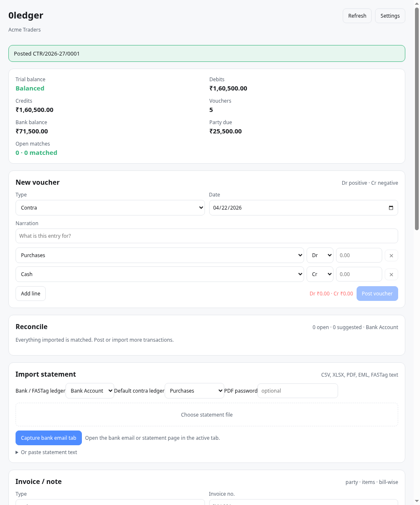
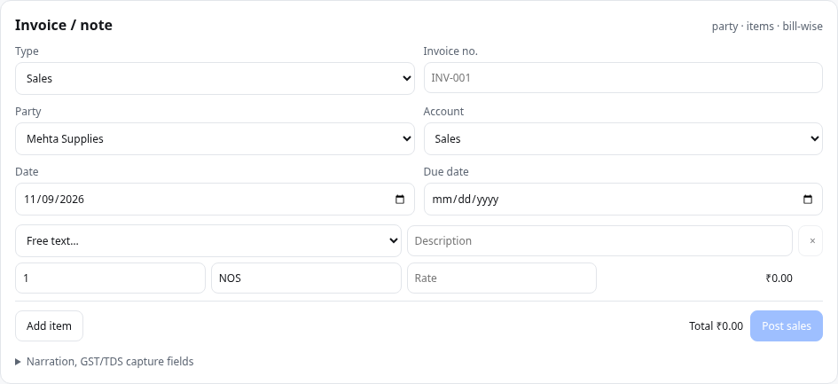
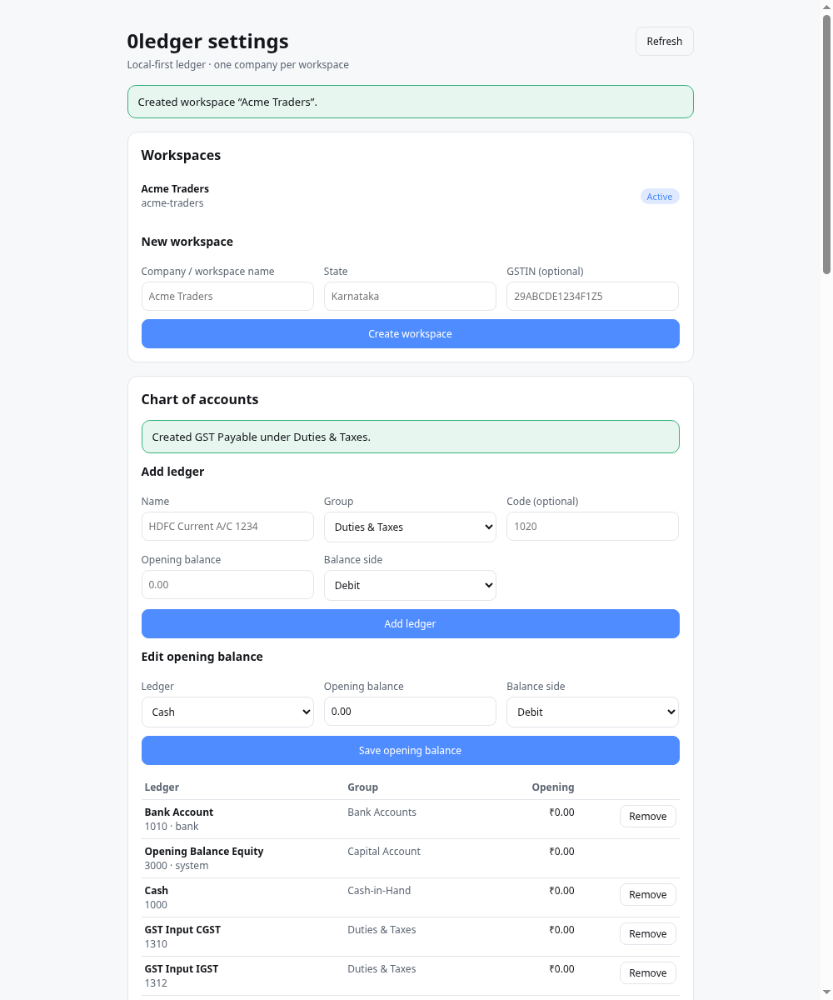

# 0ledger

Local-first, double-entry bookkeeping and tax reconciliation for Indian businesses — built as a portable Rust financial engine with Tauri + React desktop and native Android/iOS shells, with zero remote server backend.

0ledger captures financial information from email, bank statements (PDF/CSV/Excel), OCR bills and FASTag statements, turns it into a Tally-compatible ledger, reconciles GSTR-2B Input Tax Credit (ITC), and helps you close books in under 15 minutes a month. It stores everything locally first and optionally mirrors to a dedicated Google Drive folder as a live Google Sheet plus monthly `.xlsx` archives.

> Status: Active desktop product. Managed as a native desktop application via Tauri (`npm run tauri:dev` / `npm run tauri:build`). The legacy Chromium MV3 extension path has been deprecated in favor of the Tauri desktop application, which provides direct local socket access to Tally Prime (`localhost:9000`), system-level file drag-and-drop, and unbounded local storage without browser quota restrictions.

## Why

- **Local-first**: your ledger lives in a local SQLite database managed by the Rust engine; the app works completely offline.
- **No backend**: only Google APIs you explicitly authorize (optional). Raw financial data never touches remote servers.
- **1-Year Free Pro Trial**: new workspaces include a 365-day full Pro trial with GSTR-2B reconciliation and Tally bridge unlocked.
- **GSTR-2B Reconciler**: match GST portal 2B data with your purchase ledger to claim all eligible ITC and generate instant WhatsApp reminders for delinquent vendors.
- **Tally Prime Live Bridge**: 1-click direct push to your local Tally Prime installation over `http://localhost:9000` without browser CORS limitations.
- **Accountant-friendly**: generates an immutable, verified CA Close Pack (Tally XML, BRS, Trial Balance, GSTR-2B match, open exceptions).
- **India-aware**: INR + paise integers, FY April–March, 10 major banks, FASTag, GST/TDS capture fields.
- **Zero float money bugs**: every amount is an integer minor unit; round-off is always explicit.

## Screens

Screenshots use a fictional `Acme Traders` workspace and demo data. No real customer data is shown.

| Dashboard | Reports |
| --- | --- |
|  |  |
| **Invoice / note** | **Settings** |
|  |  |

See [docs/SCREENSHOTS.md](docs/SCREENSHOTS.md) for the full set, including statement import and P&L.

## What it does (target)

1. **Capture** — import `.eml`, capture a webmail message, or optionally sync Gmail.
2. **Parse** — bank/FASTag statements in PDF, password-protected PDF, CSV and Excel; statement adapters are data-driven.
3. **Post** — review parsed candidates, group them under a project / expense / accounting ID, add manual entries.
4. **Reconcile** — match statement lines to ledger vouchers; post explicit round-off; balance assertions.
5. **Mirror** — scheduled push to one Google Sheet workbook per workspace, plus monthly `.xlsx` archives.
6. **Hand off** — export to Tally XML, Beancount, CSV or OFX when needed.

## Architecture

```
Email / PDF / CSV / XLSX
          │
          ▼
   adapters + parsers (staged, confidence-scored)
          │
          ▼
  Authoritative ledger (Rust engine + SQLite)
  ├─ append-only audit hash chain + double-entry vouchers
  ├─ integer minor units + explicit round-off
  ├─ Tally-complete model (GST/TDS/forex/inventory fields captured)
  ├─ sealed device-to-device sync envelopes (ChaCha20-Poly1305)
  └─ local backups via SQLite VACUUM INTO
          │
          ├──► Google Sheets live mirror (one workbook per workspace)
          └──► monthly .xlsx archive + Tally/Beancount/CSV/OFX exports
```

- **Engine**: portable Rust crates (`crates/engine`, `crates/storage`, `crates/sync`) with no UI or network coupling.
- **UI & Runtime**: React + TypeScript, Vite, Tauri v2 desktop; Kotlin/Compose and SwiftUI mobile shells.
- **Storage**: SQLite via `zeroledger-storage` (WAL, migrations, audit chain, change log). Dexie/IndexedDB remains a read-through compatibility mirror while the desktop UI finishes its cutover.
- **Sync**: UI-agnostic, transport-agnostic change envelopes with last-writer-wins conflict resolution.
- **Parsing**: pdf.js, PapaParse, ExcelJS, postal-mime, client-side OCR.
- **No remote code**, zero-backend architecture.

## Development

```bash
npm install
npm run dev            # run desktop app in development server mode (http://localhost:1420)
npm run build          # production frontend build into dist-desktop/
npm test               # core unit tests
npm run compile        # strict type-check
npm run tauri:dev      # run native desktop window with hot reload
npm run tauri:build    # build release desktop binaries (.deb, .AppImage, .exe, .dmg)
npm run tauri:build:debug # build debug desktop binary for local testing

cargo test --workspace # Rust engine, storage and sync tests
cargo clippy --workspace --all-targets -- -D warnings
./mobile/generate-bindings.sh  # regenerate Kotlin + Swift UniFFI bindings
```

### Desktop Target (Primary)

The application is bundled into native desktop binaries via Tauri. It has direct socket communication with local Tally Prime installations (`http://localhost:9000`), native file dropzones, and persistent offline storage.

*(Note: Legacy MV3 browser extension builds can still be produced with `npm run build:mv3:deprecated` for historical reference, but all active feature development is on the Tauri desktop path).*

## Repository layout

```
crates/
  engine/           pure double-entry rules, money, validation, reports
  storage/          authoritative SQLite schema, migrations, audit chain, change log
  sync/             sealed change envelopes, LWW merge, transports
  ffi/              UniFFI surface for Kotlin and Swift
mobile/
  android/          Kotlin + Jetpack Compose shell
  ios/              SwiftUI shell
src/
  entrypoints/      background, popup, sidepanel, options
  core/
    money/          integer minor units, currency, round-off
    model/          Zod schemas + domain types
    db/             Dexie schema and repositories
    numbering/      voucher numbering schemes
    ledger/         validation, Tally readiness, reports
    backup/         encrypted AES-GCM backup and restore
    template/       single workbook template spec (xlsx + Sheets + snapshot)
    ingest/         email, statement, FASTag and Gmail adapters
    drive/          OAuth PKCE, Drive folders, Sheets mirror, archives, restore
    interchange/    Tally XML, Beancount, CSV, OFX import/export
  ui/               shared React hooks and workspace state
docs/
  PLAN.md           full product/technical plan
  ROADMAP.md        milestone tracker
  SCREENSHOTS.md    UI screenshot gallery
  screenshots/      PNG captures used by README and docs
  TALLY.md          Tally XML field mapping
tests/              Vitest + fixture harness
```

## Google Drive setup

1. Create a Google Cloud project and enable the **Google Drive API** and **Google Sheets API**.
2. Configure the OAuth consent screen (External is fine for personal use) and create an OAuth
   client of type **Web application** for the Chrome extension redirect
   `https://<extension-id>.chromiumapp.org/`.
3. Open **0ledger settings → Google Drive sync**, paste the client ID, and connect.

0ledger uses PKCE, requests only `drive.file`, stores refresh tokens in `chrome.storage.local`
(access tokens stay in memory), and only overwrites workbooks where `appProperties.app = 0ledger`.
Optional Gmail import requests `gmail.readonly` only when you enable it. Sheets mirrors are plaintext
by design; use encrypted `.0ledger` backups for portable encrypted copies.

## Interchange

Open **0ledger settings → Interchange & Tally** to download voucher lines, ledgers, trial balance,
OFX, Beancount and Tally XML. Beancount and Tally XML can also be imported back into a workspace.

Tally export runs readiness checks first (Tally parent groups, party masters, GST fields, numbering
and balances). Override with **Allow Tally export even when readiness checks fail** only if you
accept Tally-specific data loss. Imported vouchers always pass through the normal double-entry
validation and numbering path; re-imports are deduplicated.

## Privacy & security

- No 0ledger server. Nothing is uploaded unless you connect Google Drive/Sheets.
- Email bodies and statement contents are processed on-device. Parsed data is staged before commit.
- Never stores mailbox passwords. Protected PDFs ask for a password at parse time; optional "remember this batch" is encrypted.
- Google Sheets mirror is plaintext in your Drive by design; local data and backups can be encrypted.
- Scanned PDFs without a text layer are flagged as requiring OCR; this build does not bundle OCR.

See [docs/PRIVACY.md](docs/PRIVACY.md) and [docs/SECURITY.md](docs/SECURITY.md) for details.

## Contributing

Bank and FASTag formats change. Adapters are data-driven; see [docs/ADAPTERS.md](docs/ADAPTERS.md). Please submit **anonymized** statement fixtures only.

## Packaging

`npm run build` writes `.output/chrome-mv3/`; `npm run zip` creates a distributable zip. See
[docs/RELEASE.md](docs/RELEASE.md) for the release checklist.

## License

MIT
