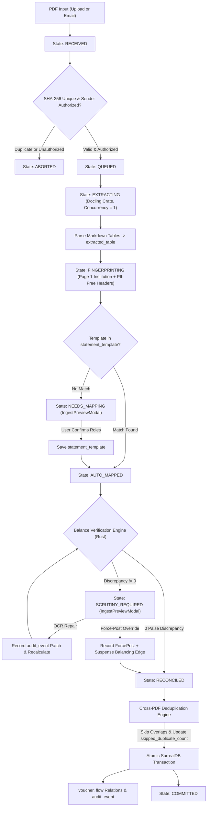

# Audited PDF Table Extraction, Template Fingerprinting, and State Machine Ingestion

*   **Author:** Hari
*   **Status:** In Review (Post-EGM Remediation)
*   **Date:** 2026-11-25

--------------------------------------------------------------------------------

## Overview

0ledger automates accounting reconciliation for Indian micro-enterprises and freelancers, aiming to close monthly books in under 15 minutes. Financial institutions (banks, credit card issuers, payment aggregators, and FASTag providers) issue statements primarily in unstructured or semi-structured PDF files.

Today, 0ledger relies on regex/text aliases in TypeScript (`src/core/ingest/parsers.ts`) over Markdown exported by the in-process `docling` Rust crate, and uses SQLite (`rusqlite`) in `crates/storage`. This design upgrades 0ledger into a **Rust-authoritative ingestion and graph ledger engine** powered by embedded **SurrealDB** (`Surreal<SurrealKv>` with `.versioned()`):

1. **In-Process Docling Table Extraction (Rust)**: Runs the embedded `docling` crate (`tauri::async_runtime::spawn_blocking`, concurrency capped at 1 via `tokio::sync::Semaphore`), reuses existing text-layer inspection and per-mailbox PDF password decryption, parses Markdown tables into structured `extracted_table` records, and stores them in local-only SurrealDB staging tables.
2. **PII-Free Template Fingerprinting**: Detects `institution_slug` from the first page via a whitelisted institution dictionary (e.g., `hdfc`, `icici`, `idfc`, `sbi`, `axis`, `kotak`, `indian`) and IFSC prefixes, strips PII headers, and fingerprints column layouts scoped by `(institution_slug, statement_kind, header_fingerprint)`.
3. **Audited Ingestion State Machine (Rust-Owned)**: Governs the lifecycle of uploaded and emailed statements in `crates/engine` + `crates/storage`, enforcing content SHA-256 deduplication across all non-`ABORTED` batches and sender authorization via existing IMAP/workspace sender filters.
4. **Optimistic Auto-Import with Exception Trapping**: Statements matching a known template with zero-paise mathematical discrepancy resolve counterparties deterministically (falling back to `ledger:uncategorized`) and commit directly to double-entry `voucher` records and `flow` graph relations. Unrecognized layouts or balance mismatches halt in `NEEDS_MAPPING` or `SCRUTINY_REQUIRED` and open the React preview/repair modal.
5. **Intra-PDF Integrity & Cross-PDF Deduplication**: Preserves identical same-day transactions within a single PDF while deduplicating overlapping date periods across successive statements by `(bank_account, reference)` (with fallback occurrence-ranked matching for unreferenced rows) and tracking `skipped_duplicate_count`.
6. **Dual-Layer Audit Patches**: Preserves immutable raw table data in `extracted_table` while logging OCR digit repairs and force-post assertions in `audit_event` (linked from `voucher` and `flow` with `flagged_scrutiny: true`).

--------------------------------------------------------------------------------

## The Problem

Indian small-business operators and bookkeepers face three chronic pain points when importing PDF financial statements into 0ledger:

1. **Brittle Extraction & Column Drift**: Hardcoded regex markers break when institutions shift columns or rename headers, and unmapped Markdown tables provide no structured way for users to assign column roles and save reusable layouts.
2. **Accidental Duplication Across Overlapping Periods**: Successive monthly statements frequently overlap at date boundaries (e.g. October 25 to November 25 followed by November 1 to November 30). Naive date-and-amount deduplication either creates duplicate vouchers or erroneously drops legitimate repeat purchases (such as two identical ₹200 UPI payments to the same vendor on the same afternoon).
3. **Audit Provenance vs. OCR Repair**: OCR and layout extractors occasionally misread characters (e.g. reading "O" as "0" or dropping negative indicators). Either users cannot repair rows and are blocked from closing books, or they edit cells freely without an audit trail, destroying non-repudiation and bank-statement provenance.

--------------------------------------------------------------------------------

## Goals

*   **Goal 1**: Extract Markdown tables from uploaded or emailed PDF statements using the embedded `docling` Rust crate with concurrency strictly capped at 1, reusing text-layer OCR-mode selection and PDF password decryption.
*   **Goal 2**: Persist raw, unmodified extracted tables in local SurrealDB staging tables (`extracted_table`) isolated from ChaCha20-Poly1305 `change_log` sync envelopes.
*   **Goal 3**: Fingerprint statement layouts using a deterministic SHA-256 hash of sanitized, PII-free column header names scoped by `institution_slug` and `statement_kind` (`bank`, `credit_card`, `p2p`, `fastag`).
*   **Goal 4**: Enforce a Rust-owned audited batch state machine tracking transitions from `RECEIVED` through `COMMITTED` with append-only `audit_event` logging.
*   **Goal 5**: Execute optimistic auto-import when a template match is found and mathematical reconciliation passes with zero discrepancy, routing unresolved counterparties to `ledger:uncategorized`.
*   **Goal 6**: Trap reconciliation mismatches and unmapped templates in `IngestPreviewModal.tsx`, allowing column role assignment, OCR character repairs backed by `audit_event` patches, or balanced `ForcePostAssertion` entries to `ledger:unreconciled_suspense`.
*   **Goal 7**: Enforce cross-statement deduplication for overlapping periods while preserving duplicate transaction amounts occurring within the same PDF statement.

--------------------------------------------------------------------------------

## Non-Goals

*   **Non-Goal 1: Legacy SQLite Data Migration**: This is a new product release; existing SQLite databases are cleared out rather than migrated.
*   **Non-Goal 2: Customer Tier Fingerprinting**: Column structures do not differ across customer tiers (e.g., HDFC Classic vs Preferred). Customer tier is excluded from fingerprint keys.
*   **Non-Goal 3: Remote / Cloud Community Template Sharing**: 0ledger is an offline-first system with no remote backend. Template definitions remain local to each workspace's embedded SurrealKV database.
*   **Non-Goal 4: Free-form Spreadsheet Editing**: User interactions in the preview screen are restricted to column role mapping and targeted OCR digit repairs on flagged discrepancy rows.
*   **Non-Goal 5: Blanket Forwarded-Email Rejection**: Client-to-bookkeeper email forwards are supported via workspace sender authorization filters.

--------------------------------------------------------------------------------

## Critical User Journeys (CUJs)

### CUJ 1: Frictionless Monthly Ingestion of Known Bank Statement
*   **Given**: An Indian SME workspace has an existing template for HDFC Savings Account statements.
*   **When**: The user drops `HDFC_Nov_2026.pdf` into 0ledger (or it arrives via an authorized email forward).
*   **Then**: Rust computes content SHA-256 (unique across non-`ABORTED` batches), acquires the single Docling worker slot, parses Markdown tables into `extracted_table`, detects `institution_slug = 'hdfc'` from page 1, matches the template, verifies running balance deltas with 0 paise discrepancy, resolves counterparties (or `ledger:uncategorized`), commits `voucher` and `flow` edges to SurrealKV, and notifies the user without opening the preview modal.

### CUJ 2: First-Time Onboarding of an Unknown Statement Layout
*   **Given**: The user uploads an ICICI Credit Card PDF with an unrecognized column layout.
*   **When**: Docling extracts Markdown table headers (`Txn Date`, `Details`, `Amount (INR)`, `Cr/Dr`) and template lookup returns no match.
*   **Then**: The state machine enters `NEEDS_MAPPING`. `IngestPreviewModal.tsx` displays the extracted columns. The user assigns column roles (`date`, `narration`, `amount`, `cr_dr`) and confirms `institution_slug`/`statement_kind`. Rust verifies closing credit card `total_due_minor`, saves the new template to `statement_template`, and commits `voucher` and `flow` records.

### CUJ 3: Resolving OCR Balance Discrepancy via Audit Patch
*   **Given**: A scanned SBI statement is parsed, but an OCR character misread causes a ₹1,000 transaction to be extracted as ₹10,000 (`1000000` paise), violating the running balance check.
*   **When**: The state machine transitions to `SCRUTINY_REQUIRED`.
*   **Then**: `IngestPreviewModal.tsx` highlights the row where the running balance equation broke. The user corrects the extracted amount to ₹1,000 (`100000` paise) with rationale `"OCR typo repair"`. Rust records an immutable `audit_event` (`repair_type: "ocr_digit_correction"`), recalculates the balance (0 paise discrepancy), transitions to `RECONCILED`, and commits the `voucher` and `flow` edge tagged `flagged_scrutiny: true`.

--------------------------------------------------------------------------------

## Technical Plan (Architecture)

### Architectural Overview

Rust (`crates/engine` + `crates/storage`) is the **single authoritative owner** of the ingestion state machine, Docling Markdown parsing, fingerprinting, balance reconciliation, deduplication, and SurrealDB (`Surreal<SurrealKv>` with `.versioned()`) persistence. TypeScript (`src/core/ingest/` and `src/ui/`) acts strictly as the frontend IPC client and interactive preview/repair UI.



---

### Storage Blueprint, SurrealKV & Schema Migrations

`crates/storage` embeds SurrealDB (`surrealdb` with `kv-surrealkv`) opened with `.versioned()` for native point-in-time historical snapshots (`VERSION d'...'`), and supports portable workspace backups via `db.export()` / `db.import()`. Legacy SQLite databases are cleared out; no SQLite-to-SurrealDB data migration is required.

#### Embedded Rust Migration Strategy
Startup migrations are embedded in `crates/storage` via `include_str!` (`0001_init.surql`, `0002_ingest.surql`), tracked in `_migrations`, and executed atomically inside `BEGIN TRANSACTION; ... COMMIT TRANSACTION;`.

#### `0001_init.surql` (Core Authoritative Ledger, Graph & Sync Schema)

```sql
-- Migration: crates/storage/migrations/0001_init.surql

DEFINE TABLE _migrations SCHEMAFULL;
DEFINE FIELD version ON _migrations TYPE int;
DEFINE FIELD name ON _migrations TYPE string;
DEFINE FIELD applied_at ON _migrations TYPE datetime DEFAULT time::now();
DEFINE INDEX idx_migrations_version ON _migrations FIELDS version UNIQUE;

-- Multi-tenant Workspace & Settings
DEFINE TABLE workspace SCHEMAFULL;
DEFINE FIELD slug ON workspace TYPE string;
DEFINE FIELD name ON workspace TYPE string;
DEFINE FIELD authorized_forwarders ON workspace TYPE array<string> DEFAULT [];
DEFINE FIELD discrepancy_count ON workspace TYPE int DEFAULT 0;
DEFINE FIELD archived ON workspace TYPE bool DEFAULT false;
DEFINE FIELD created_at ON workspace TYPE datetime DEFAULT time::now();
DEFINE FIELD updated_at ON workspace TYPE datetime DEFAULT time::now();
DEFINE INDEX idx_workspace_slug ON workspace FIELDS slug UNIQUE;

DEFINE TABLE company SCHEMAFULL;
DEFINE FIELD workspace_id ON company TYPE record<workspace>;
DEFINE FIELD legal_name ON company TYPE string;
DEFINE FIELD gstin ON company TYPE option<string>;
DEFINE FIELD currency ON company TYPE string DEFAULT 'INR';
DEFINE FIELD fy_start_month ON company TYPE int DEFAULT 4;

DEFINE TABLE numbering_scheme SCHEMAFULL;
DEFINE FIELD workspace_id ON numbering_scheme TYPE record<workspace>;
DEFINE FIELD voucher_type ON numbering_scheme TYPE string;
DEFINE FIELD prefix ON numbering_scheme TYPE string;
DEFINE FIELD next_number ON numbering_scheme TYPE int;
DEFINE FIELD reset_period ON numbering_scheme TYPE string;

-- Graph Node Tables
DEFINE TABLE ledger SCHEMAFULL;
DEFINE FIELD workspace_id ON ledger TYPE record<workspace>;
DEFINE FIELD name ON ledger TYPE string;
DEFINE FIELD normal_side ON ledger TYPE string; -- 'debit' | 'credit'
DEFINE FIELD is_system ON ledger TYPE bool DEFAULT false; -- true for ledger:uncategorized, ledger:unreconciled_suspense
DEFINE INDEX idx_ledger_ws_name ON ledger FIELDS workspace_id, name UNIQUE;

DEFINE TABLE party SCHEMAFULL;
DEFINE FIELD workspace_id ON party TYPE record<workspace>;
DEFINE FIELD name ON party TYPE string;
DEFINE FIELD gstin ON party TYPE option<string>;

DEFINE TABLE bank_account SCHEMAFULL;
DEFINE FIELD workspace_id ON bank_account TYPE record<workspace>;
DEFINE FIELD name ON bank_account TYPE string;
DEFINE FIELD institution_slug ON bank_account TYPE string;
DEFINE FIELD account_tail ON bank_account TYPE string;
DEFINE FIELD statement_kind ON bank_account TYPE string; -- 'bank' | 'credit_card' | 'p2p' | 'fastag'

-- Authoritative Vouchers & Audit Chain (Replicated)
DEFINE TABLE voucher SCHEMAFULL;
DEFINE FIELD workspace_id ON voucher TYPE record<workspace>;
DEFINE FIELD voucher_type ON voucher TYPE string;
DEFINE FIELD number ON voucher TYPE string;
DEFINE FIELD txn_date ON voucher TYPE datetime;
DEFINE FIELD currency ON voucher TYPE string DEFAULT 'INR';
DEFINE FIELD narration ON voucher TYPE option<string>;
DEFINE FIELD source ON voucher TYPE string DEFAULT 'pdf_docling';
DEFINE FIELD flagged_scrutiny ON voucher TYPE bool DEFAULT false;
DEFINE FIELD audit_patch_id ON voucher TYPE option<record<audit_event>>;
DEFINE FIELD created_at ON voucher TYPE datetime DEFAULT time::now();

DEFINE TABLE audit_event SCHEMAFULL;
DEFINE FIELD workspace_id ON audit_event TYPE record<workspace>;
DEFINE FIELD entity_type ON audit_event TYPE string;
DEFINE FIELD entity_id ON audit_event TYPE string;
DEFINE FIELD action ON audit_event TYPE string; -- 'STATE_TRANSITION' | 'OCR_PATCH' | 'FORCE_POST'
DEFINE FIELD actor ON audit_event TYPE string;
DEFINE FIELD rationale ON audit_event TYPE option<string>;
DEFINE FIELD payload ON audit_event TYPE object FLEXIBLE;
DEFINE FIELD prev_hash ON audit_event TYPE string;
DEFINE FIELD hash ON audit_event TYPE string;
DEFINE FIELD created_at ON audit_event TYPE datetime DEFAULT time::now();

-- Polymorphic Money Flow Edge (TYPE RELATION)
-- Invariant: amount_minor is strictly > 0. Direction is always OUT (credit/source) -> IN (debit/target).
DEFINE TABLE flow TYPE RELATION IN ledger|party|bank_account OUT ledger|party|bank_account SCHEMAFULL;
DEFINE FIELD workspace_id ON flow TYPE record<workspace>;
DEFINE FIELD voucher_id ON flow TYPE record<voucher>;
DEFINE FIELD edge_type ON flow TYPE string;       -- 'PAYMENT' | 'RECEIPT' | 'TRANSFER' | 'EXPENSE' | 'TAX' | 'SUSPENSE'
DEFINE FIELD amount_minor ON flow TYPE int ASSERT $value > 0;
DEFINE FIELD currency ON flow TYPE string DEFAULT 'INR';
DEFINE FIELD txn_date ON flow TYPE datetime;
DEFINE FIELD reference ON flow TYPE option<string>;
DEFINE FIELD narration_norm ON flow TYPE option<string>;
DEFINE FIELD daily_rank ON flow TYPE int DEFAULT 1;
DEFINE FIELD flagged_scrutiny ON flow TYPE bool DEFAULT false;
DEFINE FIELD audit_patch_id ON flow TYPE option<record<audit_event>>;
DEFINE INDEX idx_flow_ws_date ON flow FIELDS workspace_id, txn_date;
DEFINE INDEX idx_flow_ref ON flow FIELDS workspace_id, reference;

DEFINE TABLE rolls_up_to TYPE RELATION IN ledger OUT ledger SCHEMAFULL;

-- Sync & Replication Metadata (ChaCha20-Poly1305 envelopes)
DEFINE TABLE change_log SCHEMAFULL;
DEFINE FIELD entity_type ON change_log TYPE string;
DEFINE FIELD entity_id ON change_log TYPE string;
DEFINE FIELD op ON change_log TYPE string;
DEFINE FIELD payload ON change_log TYPE string;
DEFINE FIELD lamport ON change_log TYPE int;
DEFINE FIELD device_id ON change_log TYPE string;
DEFINE FIELD content_hash ON change_log TYPE string;
DEFINE INDEX idx_change_log_hash ON change_log FIELDS content_hash UNIQUE;

DEFINE TABLE tombstone SCHEMAFULL;
DEFINE FIELD entity_type ON tombstone TYPE string;
DEFINE FIELD entity_id ON tombstone TYPE string;
DEFINE FIELD deleted_at ON tombstone TYPE datetime;

DEFINE TABLE sync_meta SCHEMAFULL;
DEFINE FIELD key ON sync_meta TYPE string;
DEFINE FIELD value ON sync_meta TYPE string;
DEFINE INDEX idx_sync_meta_key ON sync_meta FIELDS key UNIQUE;
```

#### `0002_ingest.surql` (Local-Only Ingestion Staging & Templates)

```sql
-- Migration: crates/storage/migrations/0002_ingest.surql
-- Local-only tables: NEVER written to change_log.

DEFINE TABLE ingest_batch SCHEMAFULL;
DEFINE FIELD workspace_id ON ingest_batch TYPE record<workspace>;
DEFINE FIELD bank_account_id ON ingest_batch TYPE option<record<bank_account>>;
DEFINE FIELD source_type ON ingest_batch TYPE string;        -- 'upload' | 'imap' | 'gmail'
DEFINE FIELD source_reference ON ingest_batch TYPE option<string>;
DEFINE FIELD content_sha256 ON ingest_batch TYPE string;
DEFINE FIELD sender_address ON ingest_batch TYPE option<string>;
DEFINE FIELD state ON ingest_batch TYPE string;              -- 'RECEIVED' | 'QUEUED' | 'EXTRACTING' | 'FINGERPRINTING' | 'AUTO_MAPPED' | 'NEEDS_MAPPING' | 'SCRUTINY_REQUIRED' | 'RECONCILED' | 'COMMITTED' | 'ABORTED'
DEFINE FIELD statement_kind ON ingest_batch TYPE string;     -- 'bank' | 'credit_card' | 'p2p' | 'fastag'
DEFINE FIELD institution_slug ON ingest_batch TYPE option<string>;
DEFINE FIELD account_tail ON ingest_batch TYPE option<string>;
DEFINE FIELD total_rows ON ingest_batch TYPE int DEFAULT 0;
DEFINE FIELD reconciled_rows ON ingest_batch TYPE int DEFAULT 0;
DEFINE FIELD skipped_duplicate_count ON ingest_batch TYPE int DEFAULT 0;
DEFINE FIELD error_message ON ingest_batch TYPE option<string>;
DEFINE FIELD created_at ON ingest_batch TYPE datetime DEFAULT time::now();
DEFINE FIELD updated_at ON ingest_batch TYPE datetime DEFAULT time::now();
DEFINE INDEX idx_ingest_batch_ws_state ON ingest_batch FIELDS workspace_id, state;
DEFINE INDEX idx_ingest_batch_hash ON ingest_batch FIELDS workspace_id, content_sha256;

DEFINE TABLE extracted_table SCHEMAFULL;
DEFINE FIELD batch_id ON extracted_table TYPE record<ingest_batch>;
DEFINE FIELD table_index ON extracted_table TYPE int;
DEFINE FIELD raw_headers ON extracted_table TYPE array<string>;
DEFINE FIELD raw_rows ON extracted_table TYPE array<array<string>>;
DEFINE FIELD created_at ON extracted_table TYPE datetime DEFAULT time::now();
DEFINE INDEX idx_extracted_table_batch ON extracted_table FIELDS batch_id;

DEFINE TABLE statement_template SCHEMAFULL;
DEFINE FIELD workspace_id ON statement_template TYPE record<workspace>;
DEFINE FIELD institution_slug ON statement_template TYPE string;
DEFINE FIELD statement_kind ON statement_template TYPE string;
DEFINE FIELD header_fingerprint ON statement_template TYPE string;
DEFINE FIELD column_mappings ON statement_template TYPE object FLEXIBLE; -- Record<normalized_header_with_occurrence, ColumnRole>
DEFINE FIELD created_at ON statement_template TYPE datetime DEFAULT time::now();
DEFINE FIELD updated_at ON statement_template TYPE datetime DEFAULT time::now();
DEFINE INDEX idx_statement_template_lookup ON statement_template FIELDS workspace_id, institution_slug, statement_kind, header_fingerprint UNIQUE;
```

---

### Ingestion Batch State Machine Specification

| Current State | Transition Trigger | Next State | Guard Condition / Actions |
| :--- | :--- | :--- | :--- |
| `RECEIVED` | Content hash & sender check | `QUEUED` | No existing non-`ABORTED` `ingest_batch` shares `(workspace_id, content_sha256)`. If `source_type != 'upload'`, `sender_address` is in `workspace.authorized_forwarders` (reusing IMAP filter settings). |
| `QUEUED` | Worker slot available | `EXTRACTING` | Acquires `Semaphore(1)`, decrypts PDF if password-protected using per-mailbox passwords, selects OCR mode via text-layer check, runs `docling::DocumentConverter::export_to_markdown()`. |
| `EXTRACTING` | Markdown tables parsed | `FINGERPRINTING` | Parses Markdown tables, stitches multi-page tables with matching headers, filters non-transaction summary tables, saves to `extracted_table`. |
| `FINGERPRINTING` | Institution & template lookup | `AUTO_MAPPED` | `institution_slug` detected from page 1 whitelist/IFSC; matching template found in `statement_template`. |
| `FINGERPRINTING` | Template lookup miss | `NEEDS_MAPPING` | No template found (or `institution_slug` ambiguous). Halts for `IngestPreviewModal.tsx`. |
| `NEEDS_MAPPING` | User maps & confirms roles | `AUTO_MAPPED` | Mandatory roles mapped (`date`, `amount`/`debit`/`credit`, `narration`); template saved to `statement_template`. |
| `AUTO_MAPPED` | Balance verification runs | `RECONCILED` | Mathematical discrepancy is 0 paise for `statement_kind`. |
| `AUTO_MAPPED` | Balance verification fails | `SCRUTINY_REQUIRED` | Mathematical discrepancy $\ne 0$. Failing rows highlighted in `IngestPreviewModal.tsx`. |
| `SCRUTINY_REQUIRED` | User repairs OCR / force-posts | `RECONCILED` | OCR repair writes `audit_event` (`OCR_PATCH`) and recalculates; Force-post writes `audit_event` (`FORCE_POST`), increments `workspace.discrepancy_count`, and adds a balancing `SUSPENSE` edge to `ledger:unreconciled_suspense`. |
| `RECONCILED` | Atomic ledger commit | `COMMITTED` | Resolves counterparties (deterministic match or `ledger:uncategorized`), filters cross-PDF overlaps, updates `skipped_duplicate_count`, and atomically writes `voucher`, `flow`, `audit_event`, and `change_log`. |
| `*` (Any State) | Unrecoverable error / user abort | `ABORTED` | Terminal state (including bad PDF password or empty Markdown extraction). Failure logged to `error_message`. |

---

### Institution Detection & PII-Free Template Fingerprinting

1. **First-Page Institution Detection**: Scan page 1 Markdown/text against a whitelisted institution dictionary (`hdfc`, `icici`, `idfc`, `sbi`, `indian`, `axis`, `kotak`, `yes`, `indusind`, `paytm`, `phonepe`, `gpay`, `nhai_fastag`) and IFSC prefixes (`HDFC0`, `ICIC0`, `SBIN0`, `IDFB0`, etc.). If undetected, the batch enters `NEEDS_MAPPING` so the user selects `institution_slug` and `statement_kind` once.
2. **PII-Free Header Sanitization**: Strip headers matching PII patterns (`/\b(account\s*no|a\/c|ifsc|cust(omer)?\s*id|name|address|pan|gstin|mobile|email)\b/i`). Normalize remaining headers: `lowercase -> trim -> replace [^a-z0-9]+ with '_'`. Append occurrence suffixes (`_2`, `_3`) for duplicate column names (e.g., two `"Amount"` columns).
3. **Fingerprint & Mapping**: Key `column_mappings` by normalized header name with occurrence suffix (`Record<string, ColumnRole>`) so reordered columns map accurately. Compute:
   `HeaderFingerprint = SHA256(institution_slug || "|" || statement_kind || "|" || join(sorted_normalized_headers, "|"))`
4. **StatementKind Normalization**: Existing `StatementKind` variants in `types.ts` map onto `statement_kind` as: `bank` (`bank`, `nps`, `ppf`, `interest`), `credit_card` (`credit_card`), `p2p` (`p2p`, `gift_card`, `giftcard`), and `fastag` (`fastag`).

---

### Balance Reconciliation Engine Specifications

All math executes in Rust using integer paise (`amount_minor: i64`):

1. **Bank Accounts (`statement_kind = 'bank'`)**:
   * Seed opening balance $\text{Balance}_0$ from statement header summary (or prior committed closing balance).
   * Row-by-row invariant: $\text{CalculatedBalance}_i = \text{Balance}_{i-1} + \text{CreditMinor}_i - \text{DebitMinor}_i$, asserting $|\text{CalculatedBalance}_i - \text{ExtractedBalance}_i| = 0$.
2. **Credit Cards (`statement_kind = 'credit_card'`)**:
   * Credit cards have no running balance column; they report `previous_balance_minor` and `total_due_minor` (total to be paid).
   * Invariant: $|\text{PreviousBalance} + \sum \text{Debits} - \sum \text{Credits} - \text{TotalDue}| = 0$.
3. **P2P & FASTag (`statement_kind = 'p2p' | 'fastag'`)**:
   * Verifies that $\sum \text{LineDebits} = \text{SummaryDebits}$ and $\sum \text{LineCredits} = \text{SummaryCredits}$ (and when opening/closing wallet balance is present, $\text{Opening} + \sum \text{Credits} - \sum \text{Debits} = \text{Closing}$).

---

### Counterparty Resolution, Deduplication & Audit Patches

1. **Counterparty Resolution on Auto-Import**: During `RECONCILED -> COMMITTED`, Rust extracts payee/counterparty tokens from `narration` (e.g., UPI VPA, NEFT beneficiary, or workspace keyword rules) and matches against `party` / `ledger` records. Unmatched rows route to `ledger:uncategorized` so every `flow` relation satisfies `IN` and `OUT` constraints without blocking auto-import.
2. **Intra-PDF & Cross-PDF Deduplication**:
   * **Intra-PDF**: Never deduplicate rows within the same PDF.
   * **Cross-PDF**: Resolve `ingest_batch.bank_account_id`. For rows with a `reference` (UTR/UPI/Cheque), skip if an existing `flow` on `bank_account_id` shares `reference`. For unreferenced rows (`reference = NONE`) within an overlapping date range, skip if an existing `flow` on `bank_account_id` matches `(txn_date, amount_minor, narration_norm, daily_rank)`. Increment `ingest_batch.skipped_duplicate_count`.
3. **Dual-Layer Audit Patches**:
   * Example `OCR_PATCH` payload in `audit_event` (matching CUJ 3: ₹10,000 -> ₹1,000):
     ```json
     {
       "field": "amount_minor",
       "raw_value": "1000000",
       "repaired_value": 100000,
       "repair_type": "ocr_digit_correction",
       "actor": "user",
       "rationale": "OCR typo repair",
       "repaired_at": "2026-11-25T14:40:00Z"
     }
     ```
   * Linked from `voucher.audit_patch_id` and `flow.audit_patch_id` with `flagged_scrutiny: true`.

---

### Graph Ledger Representation & Accounting Queries (SurrealDB)

1. **Trial Balance & `normal_side`**: `amount_minor` is strictly positive (`> 0`). For each `ledger`, `<-flow` sums debits and `->flow` sums credits via `math::sum`. Net balance respects `ledger.normal_side` (`debits - credits` for `'debit'`; `credits - debits` for `'credit'`).
2. **Running Balances in Rust**: Because SurrealQL lacks SQL window functions, `get_ledger_statement_with_running_balance` fetches sorted `flow` records into Rust and computes running balances in memory via `.scan()`.
3. **Bounded CoA Rollups**: `rolls_up_to` traversals are bounded (`<-rolls_up_to{1,6}<-ledger`).
4. **Point-in-Time Snapshots & Backups**: `.versioned()` SurrealKV enables `VERSION d'...'` queries; `db.export()` / `db.import()` provide portable backups.

--------------------------------------------------------------------------------

## Alternatives Considered

### Alternative A: Relational SQLite with Property Graph Tables (`sqlite-graph` Pattern)
*   **Pros**: Single-file SQLite ecosystem, native SQL window functions, no new DB dependencies.
*   **Cons**: Requires manual `JOIN`s/recursive CTEs for polymorphic flows and custom history tables for point-in-time snapshots.
*   **Reason for Rejection**: Rejected by author: SurrealDB with embedded SurrealKV provides native `TYPE RELATION` graph edges (`flow`), `.versioned()` point-in-time snapshots, and `db.export()`/`db.import()`.

### Alternative B: TypeScript-Owned Ingestion State Machine & Dexie Persistence
*   **Pros**: Minimal changes to Rust IPC commands.
*   **Cons**: Splits business logic between TypeScript (`service.ts`) and Rust (`store.rs`), prevents mobile `crates/ffi` reuse, and duplicates state transitions.
*   **Reason for Rejection**: Rejected by author: Rust (`crates/engine` + `crates/storage`) is the single core owner; TypeScript acts purely as the frontend UI/IPC layer.

### Alternative C: Drawing Visual Bounding Boxes on Raw PDF Coordinates
*   **Pros**: Pixel-level control on borderless PDFs.
*   **Cons**: High user friction and brittle across layout shifts.
*   **Reason for Rejection**: Rejected by author: Embedded `docling` extracts table structures directly.

### Alternative D: Rejecting All Forwarded Emails & `(Date, Amount)` Deduplication
*   **Pros**: Simple heuristics.
*   **Cons**: Breaks client-to-bookkeeper email forwarding and drops legitimate identical same-day UPI payments.
*   **Reason for Rejection**: Rejected during brainstorm/review: Replaced with workspace sender authorization and reference/rank-anchored cross-PDF deduplication.

--------------------------------------------------------------------------------

## Non-Functional Requirements

*   **Security & Privacy**: `statement_template` strips all PII headers before hashing; `ingest_batch` and `extracted_table` never enter `change_log`; emailed PDFs require `sender_address` in `workspace.authorized_forwarders`.
*   **Performance & Latency**: Docling execution is capped at 1 concurrent `spawn_blocking` task via `tokio::sync::Semaphore`; running balances compute in Rust via `.scan()`. SurrealKV `.versioned()` retention pruning is deferred to a post-MVP workspace maintenance command (bounded by `db.export()` compaction in the interim).
*   **Rollout & Rollback**: Startup `.surql` migrations run inside `BEGIN TRANSACTION; ... COMMIT TRANSACTION;` with pre-migration `db.export()` snapshot safety.

--------------------------------------------------------------------------------

## Detailed Implementation Plan

### Target Files to Create/Modify

#### 1. `Cargo.toml` & `crates/storage/Cargo.toml` (Modify)
*   **Type / Scope**: Rust Workspace & Storage Crate Manifests
*   **Proposed Changes**: Add `surrealdb` (version `2.x` with `kv-surrealkv` feature) and `tokio` (`rt-multi-thread`, `sync`, `macros`) to `[workspace.dependencies]` in root `Cargo.toml`. In `crates/storage/Cargo.toml`, replace `rusqlite` with `surrealdb` and `tokio`.

#### 2. `crates/storage/migrations/0001_init.surql` & `crates/storage/migrations/0002_ingest.surql` (Create)
*   **Type / Scope**: Embedded SurrealQL Schema Scripts
*   **Proposed Changes**:
    *   `0001_init.surql`: Define all core tables (`_migrations`, `workspace`, `company`, `numbering_scheme`, `ledger`, `party`, `bank_account`, `voucher`, `audit_event`, `flow`, `rolls_up_to`, `change_log`, `tombstone`, `sync_meta`) and seed system ledgers (`ledger:uncategorized`, `ledger:unreconciled_suspense`).
    *   `0002_ingest.surql`: Define local-only `ingest_batch`, `extracted_table`, and `statement_template`.

#### 3. `crates/storage/src/error.rs`, `crates/storage/src/schema.rs`, `crates/storage/src/store.rs`, `crates/storage/src/lib.rs` (Modify)
*   **Type / Scope**: Rust SurrealDB Storage & Graph Repository
*   **Proposed Changes**:
    *   `error.rs`: Replace `StorageError::Sqlite(#[from] rusqlite::Error)` with `StorageError::Surreal(#[from] surrealdb::Error)`.
    *   `schema.rs`: Open `Surreal::new::<SurrealKv>(path).versioned()`, check `_migrations`, and execute embedded `.surql` scripts via `include_str!` inside transactions.
    *   `store.rs` & `lib.rs`: Implement async `Store` methods for ingestion state machine (`create_ingest_batch`, `transition_batch_state`, `store_extracted_tables`, `lookup_statement_template`, `save_statement_template`), counterparty resolution (`resolve_counterparty_or_uncategorized`), cross-PDF deduplication, Trial Balance (`math::sum` respecting `normal_side`), running balance (`scan` iterator), `VERSION` point-in-time queries, and `db.export()`/`db.import()`.

#### 4. `crates/ffi/src/lib.rs` (Modify)
*   **Type / Scope**: Mobile UniFFI Sync-to-Async Bridge
*   **Proposed Changes**: Wrap `Store` async calls in an internal `tokio::runtime::Runtime::block_on(...)` so synchronous Kotlin/Swift UniFFI exports continue compiling without signature breaks.

#### 5. `crates/engine/src/ingest.rs` & `crates/engine/src/lib.rs` (Create / Modify)
*   **Type / Scope**: Rust-Authoritative Ingestion, Fingerprinting & Reconciliation Engine
*   **Proposed Changes**:
    *   Parse `docling` Markdown output into `extracted_table` matrices (filtering summary tables, stitching multi-page tables).
    *   Implement page-1 whitelisted `institution_slug` detection, PII-free `header_fingerprint` generation, and `StatementKind` normalization.
    *   Implement `verify_statement_balance` for `bank` (running balance), `credit_card` (`previous_balance + debits - credits == total_due`), `p2p`, and `fastag`.
    *   Enforce intra-PDF preservation, cross-PDF deduplication (`skipped_duplicate_count`), `AuditPatch` recording, and `ForcePostAssertion` suspense balancing.

#### 6. `src-tauri/src/commands.rs`, `src-tauri/src/engine_commands.rs`, `src-tauri/src/main.rs` (Modify)
*   **Type / Scope**: Tauri IPC Commands, Async State & Docling Semaphore
*   **Proposed Changes**:
    *   `engine_commands.rs`: Change `EngineState` from `Mutex<Store>` to `Arc<Store>` (no `std::sync::Mutex` across `.await`) and make existing commands `async`.
    *   `commands.rs`: Bound `extract_pdf_with_docling_impl` (`docling` crate `spawn_blocking`) with `Arc<tokio::sync::Semaphore::new(1)>`, preserving text-layer OCR-mode selection and PDF password decryption. Add IPC commands with typed DTOs: `ingest_pdf_batch`, `get_ingest_batch_status`, `confirm_column_mapping`, `submit_ocr_audit_patch`, `force_post_batch`, and `export_surreal_snapshot`.
    *   `main.rs`: Register all 6 new commands in `tauri::generate_handler![...]`.

#### 7. `src/core/ingest/types.ts`, `src/core/ingest/service.ts`, `src/core/ingest/email.ts`, `src/core/ingest/balance.ts` (Modify)
*   **Type / Scope**: Frontend TypeScript IPC Client & Domain DTOs
*   **Proposed Changes**:
    *   `types.ts`: Define `IngestBatchState`, `IngestBatchDto`, `ExtractedTableDto`, `StatementTemplateDto`, `ColumnRole` (aligned with `parsers.ts`: `date`, `valueDate`, `description`, `debit`, `credit`, `amount`, `type`, `balance`, `reference`, `ignore`), `StatementSummaryDto` (`previousBalanceMinor`, `totalDueMinor`, `summaryDebitsMinor`, `summaryCreditsMinor`), `AuditPatchDto`, and `ForcePostAssertionDto`.
    *   `service.ts` & `balance.ts`: Route PDF ingestion and balance verification through Tauri IPC calls to Rust (`crates/engine` + `crates/storage`) instead of Dexie-only staging.
    *   `email.ts`: Forward incoming attachments to `ingest_pdf_batch` with `sender_address` for workspace `authorized_forwarders` verification.

#### 8. `src/ui/IngestPreviewModal.tsx` & Parent Ingest View (Create / Modify)
*   **Type / Scope**: React Interactive Mapping & OCR Repair Modal
*   **Proposed Changes**: Mount `IngestPreviewModal` inside the main statement import view whenever `get_ingest_batch_status` returns `NEEDS_MAPPING` or `SCRUTINY_REQUIRED`. Support institution/kind selection, per-column `ColumnRole` dropdowns, discrepancy row highlighting, OCR repair form (`submit_ocr_audit_patch`), `skipped_duplicate_count` badge, and documented `force_post_batch`.

#### 9. `README.md` & `crates/storage/tests/surreal_ingest_tests.rs` & `tests/ingest-ipc.test.ts` (Modify / Create)
*   **Type / Scope**: Documentation & Verification Suites
*   **Proposed Changes**:
    *   `README.md`: Update storage references from SQLite to SurrealDB (`SurrealKV`).
    *   `surreal_ingest_tests.rs`: Rust tests for `0001_init.surql` + `0002_ingest.surql` migrations, Markdown table parsing, `credit_card` `total_due` reconciliation, `bank` running-balance `scan`, `ledger:uncategorized` fallback, cross-PDF deduplication, `VERSION` queries, and `db.export()`/`db.import()`.
    *   `ingest-ipc.test.ts`: TypeScript tests for IPC DTO mapping and `IngestPreviewModal` state transitions (`NEEDS_MAPPING`, `SCRUTINY_REQUIRED`, `COMMITTED`).

### Verification Plan

*   **Compilation/Build**: `cargo check --workspace`, `cargo check --manifest-path src-tauri/Cargo.toml`, and `npm run build`
*   **Unit & Integration Tests**: `cargo test --workspace`, `cargo test --manifest-path src-tauri/Cargo.toml`, and `npm test`
*   **Static Analysis & Linting**: `cargo clippy --workspace`, `cargo clippy --manifest-path src-tauri/Cargo.toml`, and `npm run lint`
*   **E2E / Stress**: `npm run test:stress` (with synthetic bank, credit card, P2P, and FASTag fixtures)
